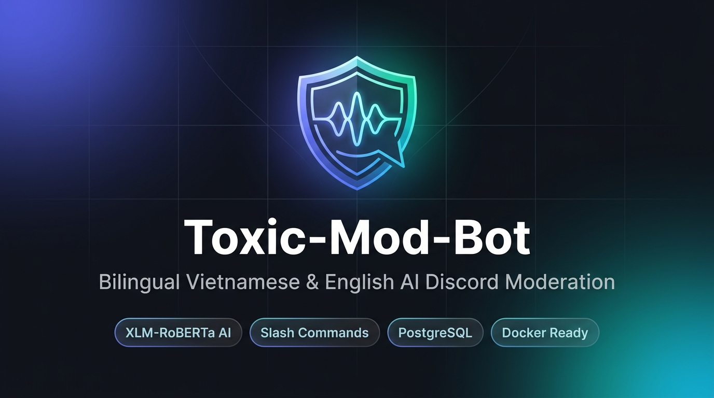
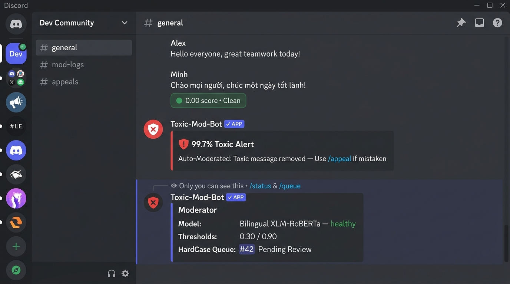
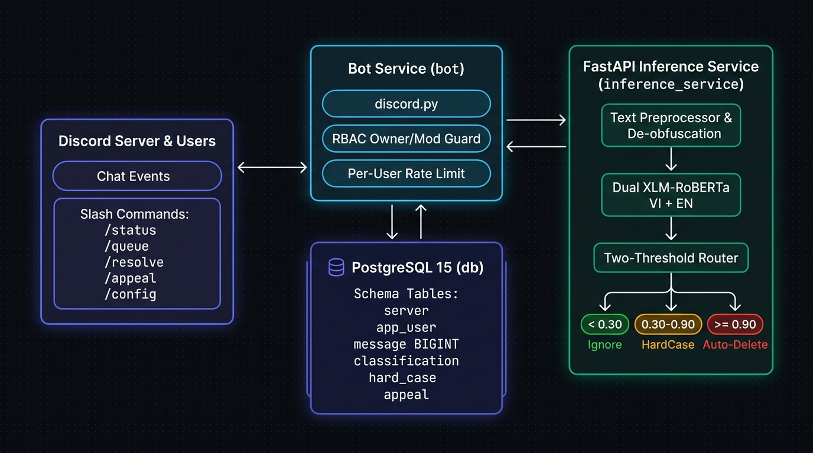

<p align="center">
  
</p>

<h1 align="center">Toxic-Mod-Bot</h1>

<p align="center">
  <strong>Bilingual Vietnamese &amp; English AI-Powered Discord Moderation Bot</strong><br/>
  Real-time toxicity detection with dual XLM-RoBERTa models, anti-evasion text normalization, native Discord Slash Commands, fail-closed RBAC, PostgreSQL persistence, and 1-command Docker Compose deployment.
</p>

<p align="center">
  <a href="https://github.com/phTrKi3n/Toxic-mod-bot/actions"></a>
  
  
  
  
  
</p>

---

## Highlights

- **Bilingual Vietnamese & English AI Detection**: Combines `thong7d/vihsd-xlmr-base-hate-speech` (fine-tuned on Vietnamese ViHSD) and `EIStakovskii/xlm_roberta_base_multilingual_toxicity_classifier_plus` (multilingual toxicity) with automatic routing and custom fine-tuned model support (`models/xlmr-finetuned`).
- **Anti-Evasion & Slang Normalization**: Strips zero-width characters, collapses obfuscated dot/dash/spaced evasion (e.g., `Đ.ồ n.g.u`, `n-g-u`, `s t u p i d`), and expands common Vietnamese abbreviations before scoring.
- **Two-Threshold Moderation Pipeline**:
  - `score >= threshold_high` (default `0.90`): Automatically deletes the message and sends a DM notification with an appeal instruction.
  - `threshold_low <= score < threshold_high` (default `0.30 – 0.90`): Flags the message into the `hard_case` queue for human review.
  - `score < threshold_low`: Allows clean messages through and records audit metadata.
- **Native Discord Slash Commands & Prefix Commands**: Full support for `/status`, `/queue`, `/appeal`, `/resolve`, `/label`, and `/config` using Discord `app_commands` (ephemeral replies, string-safe 64-bit message IDs) plus fallback `/` prefix messages.
- **Permission-Aware RBAC (`bot/rbac.py`)**: Recognizes explicit Discord roles (`admin`, `mod`, `labeler`), **Discord Server Owner (`owner_id`)**, and native Discord permissions (`Administrator`, `Manage Server`, `Manage Messages`, `Moderate Members`), cross-checked with PostgreSQL guild isolation and appeal ownership.
- **DoS & Operational Resilience**: Per-user sliding-window rate limiting on inference calls, strict 2s SLA timeout with graceful `bypass`, 64-bit Discord Snowflake `BIGINT` support on PostgreSQL, hot model reload (`/ops/reload`), and optional webhook alerting.

---

## App Preview

<p align="center">
  
</p>

---

## System Architecture

<p align="center">
  
</p>

| Component | Stack | Responsibility |
|---|---|---|
| `bot` | Python 3.11, `discord.py`, `aiohttp`, SQLAlchemy | Connects to Discord Gateway, syncs Slash Commands, enforces RBAC & per-user rate limits, calls Inference API, executes deletions/DMs, persists PostgreSQL records. |
| `inference_service` | FastAPI, Uvicorn, PyTorch, Hugging Face `transformers` | Normalizes text, runs bilingual XLM-RoBERTa models, exposes `/classify`, `/health`, and zero-downtime `/ops/reload`. |
| `db` | PostgreSQL 15 (`postgres:15-alpine`) | Stores `server`, `app_user`, `message` (`BIGINT` Snowflakes), `model_version`, `classification`, `moderation_action`, `hard_case`, and `appeal`. |

---

## Discord Bot Setup & Permissions

Before running the bot, create and configure your Discord application in the [Discord Developer Portal](https://discord.com/developers/applications):

1. Click **New Application** (e.g., `Toxic-Mod-Bot`) and copy your **Application ID** (`CLIENT_ID`) from **General Information**.
2. Open the **Installation** tab -> set **Install Link** to **None** (or include custom `bot` + `applications.commands` scopes) -> **Save Changes**.
3. Open the **Bot** tab:
   - Enable **Message Content Intent** under **Privileged Gateway Intents** -> **Save Changes**.
   - Click **Reset Token** and copy your Bot Token.
4. Invite the bot to your Discord server with the required bot permissions and Slash Command scope:

```text
https://discord.com/oauth2/authorize?client_id=<CLIENT_ID>&permissions=274878032896&scope=bot%20applications.commands
```

### Required Discord Permissions (`274878032896`)

| Permission | Purpose |
|---|---|
| `View Channels` | Read text channels in the server where moderation is active. |
| `Send Messages` & `Send Messages in Threads` | Post status/command responses when needed. |
| `Manage Messages` | Delete messages flagged above `threshold_high` (`>= 0.90`) and execute `/resolve delete`. |
| `Embed Links` & `Attach Files` | Render rich moderation notices cleanly. |
| `Read Message History` | Fetch target messages during `/resolve` moderation actions. |

### Command RBAC Resolution

`Toxic-Mod-Bot` automatically maps server members to command permissions in this order:
1. Explicit Discord role name: `admin`, `mod`, or `labeler` (case-insensitive).
2. Discord **Server Owner** (`guild.owner_id`) -> `admin`.
3. Native Discord permissions: `Administrator` / `Manage Server` -> `admin`; `Manage Messages` / `Moderate Members` -> `mod`.
4. All other human server members -> `member` (`appeal` on their own messages only).

---

## Quick Start (Docker Compose)

### 1. Clone & Configure Environment

```bash
git clone https://github.com/phTrKi3n/Toxic-mod-bot.git
cd Toxic-mod-bot
cp .env.example .env
```

Edit `.env` and set your Discord Bot Token:

```env
DISCORD_BOT_TOKEN=your_discord_bot_token_here
THRESHOLD_LOW=0.30
THRESHOLD_HIGH=0.90
```

> **Note**: Never commit `.env` to version control (`.gitignore` excludes it automatically).

### 2. Deploy Full Stack (`db` + `inference_service` + `bot`)

```bash
docker compose up -d --build
```

- On first startup (`MOCK_MODEL=false` by default in `docker-compose.yml`), `modbot_inference` downloads and caches the bilingual XLM-RoBERTa models into the persistent `hf_cache` volume (~2 minutes on first boot, ~5 seconds on subsequent restarts).
- To test quickly without downloading model weights, run:

```bash
MOCK_MODEL=true docker compose up -d --build
```

### 3. Verify Deployment

```bash
docker compose ps
curl http://localhost:8000/health
curl -X POST http://localhost:8000/classify \
  -H "Content-Type: application/json" \
  -d '{"text": "Hello everyone, great job!"}'
```

Check bot login status:

```bash
docker logs -f modbot_bot
```

---

## Local Development Setup

```bash
python -m venv .venv
# Windows PowerShell:
.\.venv\Scripts\Activate.ps1
# Linux/macOS:
# source .venv/bin/activate

pip install -r requirements.txt -r requirements-dev.txt
```

Run the Inference API and Bot in separate terminals:

```bash
# Terminal 1: FastAPI Inference Service
uvicorn inference_service.app:app --host 0.0.0.0 --port 8000

# Terminal 2: Discord Bot
python -m bot.main
```

---

## Bot Commands Reference

All commands work both as **Discord Slash Commands** (with ephemeral private replies) and **Text Prefix Commands** (`/...`).

| Command | Arguments | Required Access | Description |
|---|---|---|---|
| `/status` | — | Any Guild Member | Displays inference health, active model tag, server thresholds, and your detected RBAC role. |
| `/queue` | — | `mod` / `admin` | Lists pending borderline `HardCase` messages for the current server (sent privately via DM / ephemeral reply). |
| `/resolve` | `<message_id> <delete\|keep\|restore\|approve\|reject>` | `mod` / `admin` | Deletes or restores a flagged message, records `ModerationAction`, labels `HardCase`, or approves/rejects an appeal. |
| `/label` | `<hardcase_id> <toxic\|not_toxic>` | `labeler` / `mod` / `admin` | Assigns ground-truth labels to pending `HardCase` records for retraining. |
| `/config` | `<threshold_low\|threshold_high> <0.0–1.0>` | `admin` / Server Owner | Updates per-server classification thresholds (`threshold_low < threshold_high`). |
| `/appeal` | `<message_id> <reason>` | Message Author Only | Submits an appeal (`pending`) for one of your own moderated messages in the server. |

---

## Retraining & Zero-Downtime Model Hot-Reload

1. Prepare a merged bilingual CSV (`text`, `label`) from Jigsaw + ViHSD datasets:

```bash
python -m training.prepare_dataset
```

2. Fine-tune `xlm-roberta-base` and register a new `model_version` (`is_current=True`) in PostgreSQL:

```bash
python -m training.finetune
```

3. Hot-reload the live `inference_service` without restarting the container:

```bash
curl -X POST http://localhost:8000/ops/reload
```

---

## Testing & Benchmarks

Run the full automated test suite (69 tests covering moderation routing, Discord Slash/Prefix commands, native Owner/Mod/DB RBAC, cross-guild isolation, DoS rate limiting, `/ops/reload`, and bilingual XLM-RoBERTa evaluation):

```bash
# Fast CI mode (keyword/mock scorer)
MOCK_MODEL=true pytest tests/ --disable-warnings -v

# Full AI mode (real Hugging Face bilingual XLM-RoBERTa models)
MOCK_MODEL=false pytest tests/ --disable-warnings -v
```

Run code quality and security vulnerability checks:

```bash
black --check .
isort --check .
pip-audit -r requirements.txt
```

Benchmark live Inference Service throughput & latency:

```bash
python scripts/benchmark_latency.py
```

---

## Project Structure

```text
toxic-mod-bot/
├── assets/                   # Banner, Discord demo UI, and architecture diagram
├── bot/
│   ├── Dockerfile            # Non-root production container for Discord bot
│   ├── actions.py            # Real-time classification, DB sync, rate limiter, DM alerts
│   ├── commands.py           # Slash & prefix command handlers (/status, /queue, /resolve, /label, /config, /appeal)
│   ├── main.py               # Discord client, CommandTree sync, event loop
│   ├── monitoring.py         # Sliding-window error tracker & Discord webhook alerts
│   └── rbac.py               # Fail-closed guild-scoped RBAC (roles, owner, native permissions, DB)
├── db/
│   ├── migrations/           # Migration directory placeholder
│   ├── models.py             # SQLAlchemy 2.x ORM models (64-bit DiscordId BigInteger/SQLite hybrid)
│   └── session.py            # Database engine, session factory, and schema initializer
├── inference_service/
│   ├── Dockerfile            # Non-root CPU FastAPI inference container
│   ├── app.py                # FastAPI endpoints (/classify, /health, /ops/reload)
│   └── model_loader.py       # De-obfuscation preprocessor & dual VI/EN XLM-RoBERTa inference
├── scripts/
│   └── benchmark_latency.py  # Concurrent load & SLA (<2s) benchmark script
├── tests/                    # Automated unit, integration, RBAC, safety, and model tests
├── training/
│   ├── prepare_dataset.py    # Jigsaw + ViHSD binary dataset builder
│   └── finetune.py           # XLM-RoBERTa trainer & ModelVersion registry updater
├── .env.example              # Environment configuration template
├── docker-compose.yml        # Multi-container stack (db + inference_service + bot)
├── LICENSE                   # MIT License
├── pyproject.toml            # Black & isort configuration
├── requirements.txt          # Production dependencies
└── requirements-dev.txt      # Development, testing & audit dependencies
```

---

## License

Released under the [MIT License](LICENSE).
